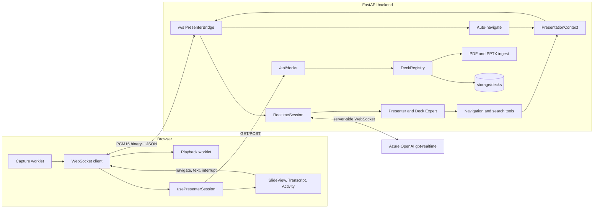
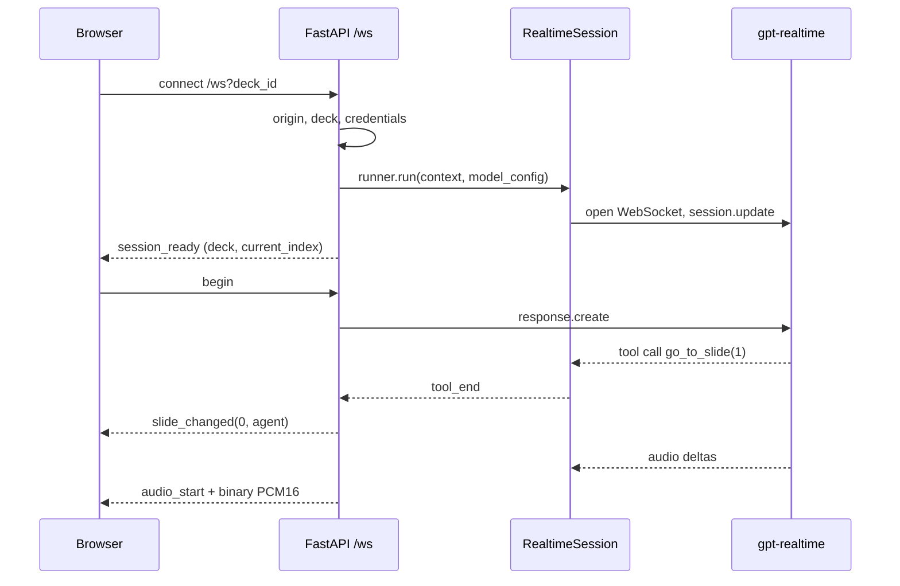
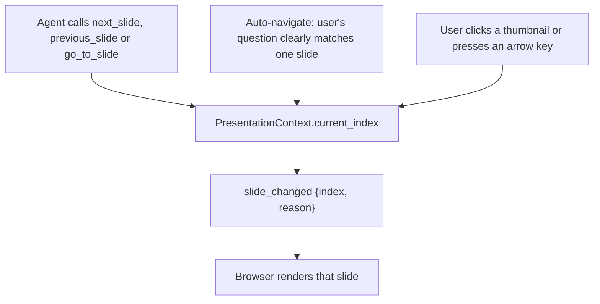
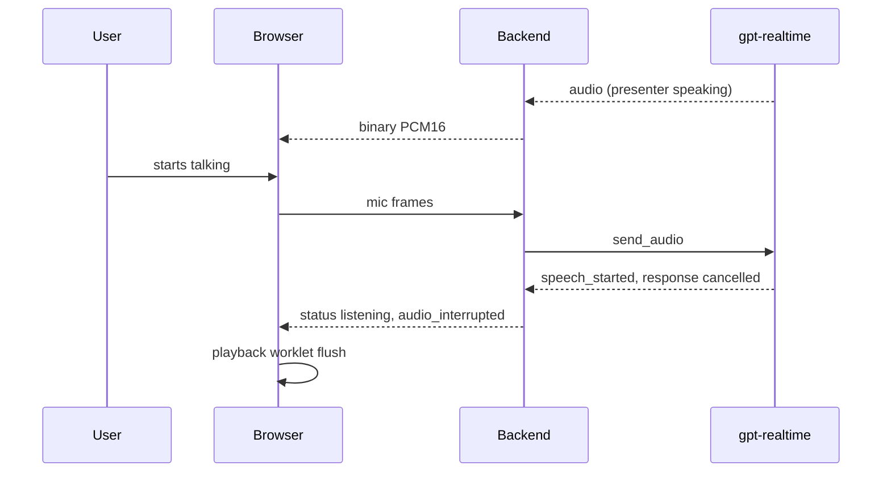
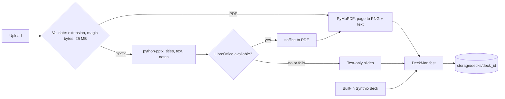

# Architecture

This document explains how the Voice Slide Presenter is put together: the components, how audio
and slide state flow between them, and why it is built this way. The agents themselves (Presenter,
Deck Expert, tools, handoffs and guardrails) are covered in
[MULTI_AGENT_WORKFLOW.md](MULTI_AGENT_WORKFLOW.md). To run the app, see
[RUN_LOCALLY.md](RUN_LOCALLY.md).

## Overview

The app has three parts:

- **Browser (React + Vite + TypeScript).** Captures the microphone, plays the presenter's voice,
  and renders the slide the backend says is current.
- **Backend (FastAPI + OpenAI Agents SDK).** Holds one realtime session per browser connection,
  runs the agents and their tools, owns the slide state, and serves the REST API for decks.
- **Realtime model (Azure OpenAI `gpt-realtime`, or OpenAI).** A speech-to-speech model: audio
  goes in and audio comes out of a single model, which also decides when to call tools.

There is **one WebSocket per presentation session**. Binary frames carry audio in both directions
and text frames carry JSON control messages. The browser never talks to the model directly, so
API keys stay on the server.

## Why a backend audio bridge

The realtime API can also be reached from the browser over WebRTC, which saves one network hop.
This project deliberately routes audio through the backend instead:

- **The agent loop runs where the state is.** Tools change slide state in Python, in the same
  process as the session, with no round trip to the browser.
- **The Agents SDK's realtime layer is server-side only.** The Python SDK runs sessions over a
  server-side WebSocket and has no browser WebRTC transport. Handoffs, guardrails and tool
  execution come from that SDK.
- **Credentials stay server-side**, so there's no need to mint short-lived browser tokens.
- **The UI is a projection of SDK events.** The Activity panel, transcript and status chip are
  built from events the backend already sees.

The cost is one extra hop and about 48 KB/s of PCM16 each way, which is negligible locally.

## Session lifecycle

Each browser connection to `/ws?deck_id=...` is handled by `presenter_ws` in
[`backend/app/ws.py`](backend/app/ws.py):

1. **Origin check.** The connection is allowed from the same host, or from origins listed in
   `ALLOWED_ORIGINS`.
2. **Deck lookup.** The deck is resolved from the registry; the built-in deck is used if no
   `deck_id` is given.
3. **Credential check.** If the provider's environment variables are missing, the browser gets a
   readable error and the socket closes.
4. **Per-session setup.** A fresh `PresentationContext` (the slide state) and a fresh set of
   agents are built. The agents' instructions embed the outline of this specific deck.
5. **Realtime session.** `RealtimeRunner.run(context=ctx, model_config=...)` opens the model
   connection. The model config comes from
   [`realtime_factory.py`](backend/app/realtime_factory.py).
6. **Two concurrent tasks** run until either finishes:
   - `receive_loop`: browser to model (audio frames and control messages).
   - `pump_events`: model to browser (audio, slide changes, transcript, activity, status).
7. **Cleanup.** Both tasks are cancelled, the session context exits, and the socket closes.

The browser sends `begin` only after its audio engine is running. That's why the greeting is
never cut off or played before the player is ready.

## Audio path

| Direction | Format | Where |
| --- | --- | --- |
| Mic to model | PCM16, 24 kHz, mono, 960-sample (40 ms) frames | [`capture-processor.js`](frontend/public/worklets/capture-processor.js) to `session.send_audio()` |
| Model to speaker | PCM16, 24 kHz, mono, chunk size set by the model | SDK `audio` events to [`playback-processor.js`](frontend/public/worklets/playback-processor.js) |

- The browser opens an `AudioContext` at 24 kHz so no resampling is needed in Chrome. Firefox
  can't connect a microphone to a context whose rate differs from the device, so the app then
  captures in a native-rate context and the capture worklet resamples to 24 kHz.
- Echo cancellation, noise suppression and auto gain are requested from `getUserMedia`.
- **Mute** disables the microphone track rather than stopping it. The model receives silence,
  so its voice activity detection still sees your turn end.
- The playback worklet keeps a queue of chunks. Each chunk is tagged with the transcript item it
  belongs to, and the worklet reports how many samples of each item have actually played. The
  transcript uses that to stay in step with the voice.

## Slide state: the backend is the single source of truth

`PresentationContext.current_index` in
[`backend/app/agents/context.py`](backend/app/agents/context.py) is the only place the current
slide lives. The browser renders whatever index the last `slide_changed` message carried and
never changes the slide on its own during a session.

The slide can change in three ways:

1. **Agent tool call.** A navigation tool updates the context. When the SDK reports `tool_end`
   for a navigation tool, the bridge sends `slide_changed(reason="agent")`. Duplicate messages
   for the same index are suppressed.
2. **Auto-navigate (server-side safety net).** The model doesn't always call a navigation tool
   when you ask about a topic. So when your question is known (the transcription of your speech
   completes, or you type a question), the bridge runs the deck search itself. If one slide is a
   clear winner (score at least 30 and at least 10 points ahead of the runner-up), it moves
   there. It then tells the model with a system message: `[Screen now shows slide N: ...]`. It
   does nothing if an agent already navigated during this turn. This step needs working speech
   transcription (`TRANSCRIBE_MODEL`).
3. **Manual navigation.** The browser sends `navigate{index}`. The bridge cancels whatever the
   presenter was saying, moves the slide, sends `slide_changed(reason="user")`, and tells the
   model `[User moved to slide N: <title>]. Briefly present it.` That message is hidden from the
   transcript.

Details of the search scoring are in
[MULTI_AGENT_WORKFLOW.md](MULTI_AGENT_WORKFLOW.md#retrieval-search_deck).

## Interruption (barge-in)

There are two layers, so the voice stops fast and the model also stops generating:

- **Voice barge-in.** The session uses `semantic_vad` turn detection with
  `interrupt_response: true`. When the model hears you start speaking it cancels its response,
  and the SDK emits `audio_interrupted`. The bridge forwards it, and the browser posts `flush` to
  the playback worklet. The worklet drops its whole queue on the next audio render, a few
  milliseconds later. The SDK also truncates the presenter's message in the conversation history
  to what was actually played.
- **Manual interrupt, typed questions and thumbnail clicks.** The browser flushes its own
  playback immediately, then tells the backend. In this SDK version, with
  `interrupt_response: true`, `session.interrupt()` only truncates playback and doesn't stop the
  model. So the bridge sends `RealtimeModelSendInterrupt(force_response_cancel=True)`, which
  cancels the response.
- **Tuning.** `VAD_EAGERNESS` (`auto`, `low`, `medium`, `high`) controls how quickly the model
  decides you've started or finished speaking. `low` helps on laptop speakers, where the
  presenter can otherwise hear itself.

## Transcript

- **The backend** keeps a simplified transcript (`TranscriptTracker` in `ws.py`). It is built
  from SDK history events plus live text deltas, and holds user and assistant messages only,
  capped at 60 items. A full snapshot is sent on every change.
- **The presenter's words** come from the realtime model's own transcript of its speech.
- **Your words** come from a separate transcription model (`TRANSCRIBE_MODEL`). If transcription
  fails, your turn shows as `(voice message - transcription unavailable)` and the UI shows an
  error once.
- **In the browser,** `SpeechClock` ([`speechClock.ts`](frontend/src/lib/speechClock.ts))
  reveals the presenter's text in step with the audio that has actually played. The model
  streams text much faster than it speaks. The clock estimates the speaking rate (15 characters
  per second until the item's full audio length is known, then the exact rate) and cuts at word
  boundaries.

## Status and latency

The status chip shows `listening`, `thinking` or `speaking`:

- `input_audio_buffer.speech_started` means `listening`.
- `speech_stopped` means `thinking`, and starts the latency timer.
- `speaking` is confirmed by the browser's player when sound actually starts, not by the server.
  This prevents the chip from showing "speaking" while audio is still in transit.

**Latency** is measured on the backend: from the end of your speech, a typed question, a manual
navigation, or `begin`, to the first audio chunk the model returns. It includes any tool calls in
between, but not the browser-to-backend hop or the playback buffer. It is shown as
`response_latency_ms` in the bottom bar.

## WebSocket protocol

Defined in [`backend/app/protocol.py`](backend/app/protocol.py) and mirrored in
[`frontend/src/lib/protocol.ts`](frontend/src/lib/protocol.ts). Slide indexes are 0-based.

**Client to server**

| Message | Meaning |
| --- | --- |
| binary frame | PCM16 mic audio, 24 kHz mono |
| `begin` | audio is ready; start the greeting (once per session) |
| `navigate {index}` | the user picked a slide |
| `text {text}` | a typed question (1-2000 characters) |
| `interrupt` | stop the presenter now |

**Server to client**

| Message | Meaning |
| --- | --- |
| binary frame | PCM16 presenter audio |
| `session_ready {deck, current_index}` | the realtime session is open |
| `slide_changed {index, reason}` | show this slide; `reason` is `agent` or `user` |
| `audio_start {item_id}` | following audio frames belong to this transcript item |
| `audio_end {item_id}` | the model finished sending audio for an item |
| `audio_interrupted` | barge-in: drop queued audio |
| `status {state}` | `listening`, `thinking` or `speaking` |
| `transcript {items}` | full transcript snapshot |
| `activity {kind, label, detail, status, ref, result}` | an agent response, tool call (start and result), handoff, guardrail pass or trip, input check, deck scan, or live reply eval; entries sharing a `ref` update in place |
| `metrics {response_latency_ms}` | latency of the last response |
| `error {message}` | something the user should see |

## REST API

Defined in [`backend/app/main.py`](backend/app/main.py).

| Endpoint | Purpose |
| --- | --- |
| `GET /api/health` | provider, agent mode, whether credentials are set, whether `soffice` is on the path |
| `GET /api/decks` | the built-in deck plus uploaded decks |
| `POST /api/decks` | upload a PPTX or PDF (multipart `file`); returns a `DeckManifest` |
| `GET /api/decks/{deck_id}` | one deck manifest |
| `GET /api/decks/{deck_id}/slides/{n}.png` | a rendered slide image (`n` is 1-based) |

In `make serve` mode, the same app also serves the built frontend from `frontend/dist`.

## Decks and ingestion

Every deck, built-in or uploaded, becomes the same `DeckManifest`
([`backend/app/decks/models.py`](backend/app/decks/models.py)): a list of slides with title,
bullets, full text, speaker notes and an optional image URL. Everything after ingestion is
identical regardless of where the deck came from.

- **Built-in deck.** Six Synthio Labs slides defined in code
  ([`builtin.py`](backend/app/decks/builtin.py)) and rendered as styled HTML.
- **PDF.** Each page is rendered at 1.5x to PNG and its text extracted. The title is the
  largest-font line.
- **PPTX.** Text and speaker notes come from python-pptx. LibreOffice converts the file to PDF
  for images (isolated profile, 60-second timeout), and the two are merged by slide index.
  Without a working LibreOffice, slides are text-only and the reason is returned in an
  `X-Deck-Warning` header.
- **Limits.** 25 MB and 40 slides; random deck IDs; sanitized filenames; cleanup on failure.

## Configuration and providers

[`backend/app/config.py`](backend/app/config.py) reads `.env` through pydantic-settings.
[`realtime_factory.py`](backend/app/realtime_factory.py) turns it into the SDK's model config:

| Provider | Connection |
| --- | --- |
| Azure | `wss://<resource>/openai/v1/realtime?model=<deployment>` with an `api-key` header. The model name sent in `session.update` is the deployment name. Server-side tracing is turned off, because it is an OpenAI-platform feature. |
| OpenAI | API key plus `OPENAI_REALTIME_MODEL` |

Both use the same session settings: PCM16 in and out, `semantic_vad` with `interrupt_response`,
the configured voice, speaking speed (`REALTIME_SPEED`, default `1.15`) and transcription model,
and automatic tool choice. The output guardrails (`no_medical_advice`, `grounded_numbers`) are
checked every 60 characters of output. `GROUNDING_GUARDRAIL=false` removes `grounded_numbers`.

## Code map

| Path | Responsibility |
| --- | --- |
| `backend/app/main.py` | FastAPI app, REST routes, static frontend |
| `backend/app/ws.py` | `PresenterBridge`: audio bridge, event mapping, auto-navigate, input guard, interrupts, transcript |
| `backend/app/protocol.py` | WebSocket message models |
| `backend/app/realtime_factory.py` | model config and runner for Azure or OpenAI |
| `backend/app/config.py` | settings from `.env` |
| `backend/app/agents/` | agents, tools, prompts, guardrails, per-session context ([details](MULTI_AGENT_WORKFLOW.md)) |
| `backend/evals/` | scenario eval cases, live runner and scoring (`make eval`) |
| `backend/app/decks/` | manifest models, built-in deck, PDF and PPTX ingest, registry, search |
| `frontend/src/hooks/usePresenterSession.ts` | session state machine: connect, start, stop, navigate, text, interrupt, mute |
| `frontend/src/lib/wsClient.ts` | WebSocket client splitting binary audio from JSON |
| `frontend/src/lib/audio.ts` | `AudioContext`, mic capture, flushable player |
| `frontend/src/lib/speechClock.ts` | paces the transcript to the audio |
| `frontend/public/worklets/` | capture and playback AudioWorklets |
| `frontend/src/components/` | deck picker, slide view, thumbnail strip, controls, transcript, activity panel, text box |

## Security and limits

This is a local prototype, not a hardened service:

- No authentication. Sessions and uploaded decks are in memory and on local disk.
- WebSocket origins are restricted to the same host or `ALLOWED_ORIGINS`.
- Client JSON messages are validated against the protocol models, and typed questions are
  capped at 2000 characters.
- Uploads are validated by extension and file signature, size- and slide-limited, stored under
  random IDs, and cleaned up on failure.
- API keys live only in the backend's `.env`.
- Typed and spoken input is checked for prompt-injection phrasing before it can steer the agent,
  and uploaded decks are scanned for instruction-like text
  ([details](MULTI_AGENT_WORKFLOW.md#prompt-injection-and-the-input-guard)). This is a
  pattern check, not a complete defence.

## Testing and CI

- `make test` runs the pytest suite. It needs no keys. `test_ws.py` drives the WebSocket bridge
  end to end against a fake realtime model: greeting, tool calls, slide changes, audio
  forwarding, metrics, manual navigation, typed questions, interrupts and errors.
- `make check` runs lint, format check, tests and the frontend production build.
- `make eval` runs scripted conversations against the live realtime provider and scores
  navigation, grounding, safety and injection handling. It needs keys, so CI does not run it;
  its scoring logic is unit-tested in `make test`.
- [`.github/workflows/ci.yml`](.github/workflows/ci.yml) runs `make install-ci` and `make check`
  on pushes to `master` and on pull requests.
