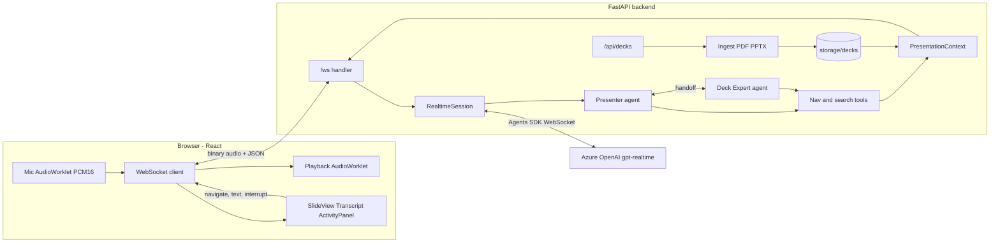

# Voice Slide Presenter

A voice-first AI presenter. Pick a deck (a built-in 6-slide Synthio Labs overview, or any PPTX/PDF
you upload), press **Start**, and an agent presents it out loud. Ask questions by voice and it
jumps to the right slide; talk over it and it stops immediately.

## Demo

[Watch the 2-minute demo video](https://drive.google.com/file/d/12fi2CMFOroMU5P3y0P7CffQGl6RZdIPB/view?usp=sharing)

The demo shows voice narration, interruption, question-based slide navigation, agent activity,
and safety checks.

- **Frontend:** React 18 + Vite + TypeScript, Web Audio AudioWorklets (PCM16, 24 kHz mono).
- **Backend:** FastAPI + OpenAI Agents SDK realtime (`openai-agents`), speech-to-speech via
  **Azure OpenAI `gpt-realtime`** (OpenAI is an env-swappable fallback).
- **Transport:** one WebSocket carrying binary audio frames and JSON control messages.

## Features

| Requirement | How it works |
| --- | --- |
| Present 5-6 slides | Built-in Synthio Labs deck (HTML-rendered) plus PPTX/PDF upload (rendered to images). |
| Change slides from questions | Agent tools (`go_to_slide`, `search_deck`, ...) mutate slide state owned by the backend, which pushes `slide_changed` to the UI. |
| Interruptible | Server-side `semantic_vad` with `interrupt_response: true`; the backend forwards `audio_interrupted` and the browser flushes its playback queue within one audio frame. A manual **Interrupt** button forces `response.cancel`. |
| Frontend + backend | React app and FastAPI service; `make serve` runs both on one port. |

Extras that show off the agent design (all visible in the **Agent Activity** tab):

- **Two agents** - a Presenter and a Deck Expert - linked with bidirectional `realtime_handoff`.
- **Navigation + retrieval tools** - `next_slide`, `previous_slide`, `go_to_slide`, `search_deck`
  (rapidfuzz keyword scoring), `get_slide_details`.
- **Guardrails** - output guardrails `no_medical_advice` (dosing/treatment recommendations) and
  `grounded_numbers` (figures that are not in the deck) cancel the response and the model
  rephrases; typed or spoken prompt-injection attempts are blocked before they reach the agent,
  and uploaded decks are scanned for instruction-like content.
- **Scenario evals** - `make eval` runs ~18 scripted conversations (navigation, grounded Q&A,
  out-of-scope, safety, injection) against the live realtime model and scores them.
- **Latency readout** (end of user speech to first audio byte), transcript, typed-question
  fallback, thumbnail strip, keyboard shortcuts (arrow keys to navigate, Space to mute).

## Quick start

Prerequisites: [uv](https://docs.astral.sh/uv/), Node.js 20+, and LibreOffice (`soffice`) for
rendering PPTX slides as images (`brew install --cask libreoffice` on macOS). Without LibreOffice,
PPTX uploads still work but show text-only slides. Run `make check-deps` to see what is missing.

```bash
cp .env.example .env      # then fill in your Azure OpenAI (or OpenAI) credentials
make install              # uv sync + npm ci
make smoke                # optional: confirms the realtime deployment returns audio
make serve                # builds the frontend, serves everything on http://127.0.0.1:8000
```

For development with hot reload, run `make dev` and open http://localhost:5173 (Vite proxies
`/api` and `/ws` to the backend on :8000).

Use **headphones**: with laptop speakers the presenter can hear itself and interrupt itself
(echo cancellation helps but is not perfect).

### Environment variables

| Variable | Default | Purpose |
| --- | --- | --- |
| `REALTIME_PROVIDER` | `azure` | `azure` or `openai` |
| `AZURE_OPENAI_ENDPOINT` | - | e.g. `https://my-resource.openai.azure.com` |
| `AZURE_OPENAI_API_KEY` | - | sent as the `api-key` header |
| `AZURE_OPENAI_REALTIME_DEPLOYMENT` | `gpt-realtime` | your realtime deployment name |
| `OPENAI_API_KEY` | - | only for `REALTIME_PROVIDER=openai` |
| `OPENAI_REALTIME_MODEL` | `gpt-realtime-2.1` | only for `REALTIME_PROVIDER=openai` |
| `REALTIME_VOICE` | `ash` | output voice |
| `REALTIME_SPEED` | `1.15` | speaking speed multiplier, `0.25`-`1.5` (`1.0` is the model's natural pace) |
| `TRANSCRIBE_MODEL` | `gpt-4o-transcribe` | transcribes the user's speech for the Transcript panel; on Azure, the name of a transcription deployment in the same resource |
| `VAD_EAGERNESS` | `auto` | `low` reduces self-interruptions on speakers |
| `AGENT_MODE` | `multi` | `multi` (Presenter + Deck Expert) or `single` (one merged agent, lower latency) |
| `GROUNDING_GUARDRAIL` | `true` | set `false` to turn off the `grounded_numbers` output guardrail |
| `ALLOWED_ORIGINS` | localhost dev/serve origins | comma-separated origins allowed to open `/ws` |

Azure is reached through the **GA** realtime endpoint
`wss://<resource>.openai.azure.com/openai/v1/realtime?model=<deployment>` with an `api-key`
header (never the legacy `/openai/realtime?api-version=...` preview path). The endpoint value is
normalized, so pasting `https://...azure.com/openai/v1/` also works.

### Make targets

| Target | What it does |
| --- | --- |
| `make install` | `uv sync` (backend) + `npm ci` (frontend) |
| `make install-ci` | same install, but `uv sync --frozen` so the lockfile cannot drift |
| `make dev` | backend (:8000, reload) and Vite (:5173) in parallel |
| `make backend` / `make frontend` | run one side only |
| `make serve` | build the frontend and serve it plus the API from :8000 |
| `make test` | pytest suite |
| `make lint` | ruff check + ruff format --check + tsc + eslint |
| `make fmt` | ruff fix + format |
| `make check` | lint, format check, pytest, and the frontend production build (same as CI) |
| `make smoke` | connect to the configured realtime provider and wait for the first audio event |
| `make eval` | run the scenario evals against the realtime provider (see [Evals](#evals)) |
| `make sample-pptx` | write `backend/samples/sample_deck.pptx` for upload testing |
| `make check-deps` | check uv, node, npm, soffice (warns if `soffice` is missing or broken) and `.env` |
| `make docker-build` / `make docker-run` | single image with LibreOffice bundled |
| `make clean` | remove build output, caches and uploaded decks |

The Makefile uses relative paths only, so it works from directories whose path contains
characters like `&`.

### CI

[`.github/workflows/ci.yml`](.github/workflows/ci.yml) runs on pushes to `master`, on pull
requests, and when started manually. It installs Python 3.12 and Node 22, runs `make install-ci`,
then `make check` (ruff, `ruff format --check`, `tsc`, ESLint, pytest, and the frontend
production build). Locally that is the same command: `make check`. It does not call Azure or
OpenAI, and it does not build the Docker image.

### Evals

`make eval` runs the cases in [`backend/evals/cases.json`](backend/evals/cases.json) against the
configured realtime provider. Each case opens a fresh session on the built-in deck and sends
typed turns through the real WebSocket bridge, so auto-navigation, the input guard, tools,
handoffs and output guardrails behave exactly as in the browser. A case can assert the final
slide, tools called, a handoff, a blocked input, required or forbidden phrases, allowed guardrail
trips and latency. Every case also fails on errors, an empty reply, medical advice, figures that
are not in the deck, or an unexpected guardrail trip.

```bash
make eval                                   # all cases, AGENT_MODE, text output (fast, cheap)
make eval ARGS="--mode single"              # the single-agent setup
make eval ARGS="--audio"                    # audio output, closest to production
make eval ARGS="--case nav- --repeat 3"     # one group, 3 runs each to expose flakiness
```

It prints PASS/FAIL per case with reasons, a per-category summary and the median time to first
output, and saves a JSON report to `backend/evals/results/` (git-ignored). It exits non-zero
when the pass rate is below `--min-pass` (default 0.9), so it can gate prompt changes. The
scoring logic itself is unit-tested in `tests/test_evals.py` and runs in CI without keys.

## Using it

1. Pick the built-in deck, or drag a `.pptx`/`.pdf` onto the upload area (25 MB / 40 slides max).
2. Press **Start** and allow the microphone. The presenter greets you and presents slide 1.
3. Ask things like "what products do you have?" (jumps to slide 4) or "how do you keep answers
   compliant?" (slide 5). Say "next" or "go back to integrations" to navigate by voice.
4. Talk over the presenter at any time; it stops and answers what you just said.
5. Click a thumbnail or use the arrow keys to navigate manually; the agent is told and briefly
   presents the new slide. Space toggles mute. **Stop** ends the session; **Restart** reconnects.

## Architecture

For the full write-up, see:
- [ARCHITECTURE.md](ARCHITECTURE.md): components, session lifecycle, audio path, slide state,
  interruption, transcript, protocol and ingestion.
- [MULTI_AGENT_WORKFLOW.md](MULTI_AGENT_WORKFLOW.md): the Presenter and Deck Expert agents, tools,
  handoffs, auto-navigation, guardrails and the input guard, with worked examples.



### REST API

- `GET /api/health` - provider, agent mode, whether credentials are configured, `soffice` on PATH.
- `GET /api/decks` - built-in deck plus uploaded decks (newest first).
- `POST /api/decks` - multipart `file` (PPTX or PDF); returns a `DeckManifest`. If PPTX rendering
  fell back to text-only slides, the reason is in the `X-Deck-Warning` response header.
- `GET /api/decks/{deck_id}` - one manifest.
- `GET /api/decks/{deck_id}/slides/{n}.png` - rendered slide image (`n` is 1-based).

### WebSocket protocol (`/ws?deck_id=...`)

Defined in `backend/app/protocol.py` and mirrored in `frontend/src/lib/protocol.ts`. Slide
indexes in messages are 0-based.

- **Client to server:** binary PCM16 frames (24 kHz mono, 960 samples = 40 ms), `begin` (sent once
  playback is ready; triggers the greeting), `navigate{index}`, `text{text}`, `interrupt`.
- **Server to client:** binary PCM16 frames, `session_ready{deck, current_index}`,
  `slide_changed{index, reason: agent|user}`, `audio_interrupted`, `audio_end`,
  `status{state: listening|thinking|speaking}`, `transcript{items}`,
  `activity{kind: agent|tool|handoff|guardrail|eval, label, detail, status, ref, result}`,
  `metrics{response_latency_ms}`,
  `error{message}`.

### Deck ingestion

Every source produces the same `DeckManifest` (`backend/app/decks/models.py`), so everything after
ingestion is source-agnostic.

- **PDF:** PyMuPDF renders each page at 1.5x to PNG and extracts text; the title is the
  largest-font line (falls back to the first line).
- **PPTX:** python-pptx extracts title placeholders, body text, tables and speaker notes;
  `soffice --headless --convert-to pdf` (isolated profile, 60 s timeout) renders it, the PDF
  pipeline makes images, and the python-pptx text/notes are merged by slide index. If `soffice` is
  missing, broken or times out, the deck uses text-only slides that the UI renders as styled HTML.
- **Validation:** extension allow-list, magic bytes (`%PDF` / zip `PK`), filename sanitizing, 25 MB
  and 40-slide limits, random deck IDs (no path traversal), cleanup on failure.

## Design decisions and trade-offs

- **Backend audio bridge instead of browser-direct WebRTC.** WebRTC straight to the realtime API
  would shave one network hop, but it would put the agent loop (tools, handoffs, guardrails) in the
  browser and require minting ephemeral keys. Running the Agents SDK session on the server keeps
  credentials server-side, lets tools mutate trusted slide state directly, and makes the activity
  panel a simple projection of SDK events. The cost is one extra hop (browser to FastAPI) and
  PCM16 over WebSocket (~48 KB/s each way), which is fine on a normal connection.
- **The backend owns slide state.** `PresentationContext.current_index` is the only source of truth.
  Tools change it; the handler emits `slide_changed` on `tool_end` (or on manual navigation), and
  the UI just renders the index. This avoids the UI and the agent disagreeing about which slide
  is visible.
- **Two-layer interruption.** Server VAD cancels the response and the SDK emits
  `audio_interrupted`; the browser flushes its AudioWorklet queue (a single `postMessage`), so
  audio stops within one render quantum after the event arrives. Because
  `interrupt_response: true` makes the SDK's plain `session.interrupt()` only truncate playback,
  manual interrupts, typed questions and thumbnail clicks send an interrupt with
  `force_response_cancel=True` so generation actually stops.
- **Agents are built per session** because their instructions embed the chosen deck's outline.
  `AGENT_MODE=single` merges Presenter and Deck Expert into one agent if handoffs add latency
  or confusion.
- **In-memory, synchronous tools.** Navigation and search work on the in-memory manifest, so tool
  calls add effectively no latency beyond the model's own tool-call round trip.
- **Keyword search over embeddings.** Decks are small (at most 40 slides); rapidfuzz token matching
  with field weights (title > body > notes) and IDF weighting is instant, typo-tolerant and needs
  no extra model or index. The agent sees the top two hits and picks the slide.
- **Provider factory.** `realtime_factory.build_model_config` returns either the Azure GA URL +
  `api-key` header (with server-side tracing disabled) or an OpenAI API key + model name, so the
  rest of the code is provider-agnostic.

## Latency

The backend measures time from `input_audio_buffer.speech_stopped` (or from a typed
question / manual navigation) to the first audio frame it forwards, and sends it to the UI as
`metrics`. It includes model time-to-first-audio plus any tool round trips, but not the
browser-to-backend hop or the browser's output buffer.

Typical values could not be recorded for this submission because no Azure/OpenAI credentials were
available in the build environment (see Known limitations). Expectations, based on the design:
the backend bridge adds only a few milliseconds locally, tools are in-memory, and `semantic_vad`
decides end-of-turn itself (eagerness `auto`), so perceived latency is dominated by the realtime
model's time-to-first-audio. Responses that first call a tool (for example `search_deck` then
`go_to_slide`) add one tool round trip. If handoffs feel slow, set `AGENT_MODE=single`.

## Testing

`make test` runs 97 pytest tests (no network or credentials needed):

- `test_ingest_pdf.py` - generated 3-page PDF: titles, text, PNG output, slide limit, corrupt file.
- `test_ingest_pptx.py` - text/notes extraction, missing and broken `soffice` fallbacks, registry
  round trip, upload validation, filename sanitizing, path traversal.
- `test_tools.py` - navigation bounds and context changes (invoked like the SDK does), details,
  search tool output, multi/single agent wiring, guardrail regex.
- `test_search.py` - ranking for representative questions, typo tolerance, stopwords, and
  navigation commands ("go back one slide") not triggering auto-navigation.
- `test_guardrails.py` - grounded vs invented figures, streaming partial text, numbers the user
  said, prompt-injection phrasings vs normal questions, deck content scanning.
- `test_evals.py` - the eval case file is valid and the scorer passes and fails runs correctly.
- `test_config.py` - Azure GA URL and `api-key` header construction, endpoint normalization,
  OpenAI fallback, env var selection, missing-credential detection.
- `test_ws.py` - the WebSocket bridge end to end against a fake realtime model: `begin` triggers
  `response.create`, a `go_to_slide` tool call produces `activity` and `slide_changed`, audio is
  forwarded as binary with `status` and `metrics`, user navigation/text/interrupt, error paths,
  a blocked prompt-injection message, and the REST endpoints including a PDF upload.

Manual end-to-end checklist (needs credentials and a microphone): greeting plays; "what products
do you have" moves to slide 4; talking over the agent stops audio in under 300 ms; "go back"
works; clicking a thumbnail syncs the agent; an uploaded PDF and PPTX both present; a dosing
question trips the guardrail; Stop and Restart work cleanly. Most of the agent-behaviour items are
also covered automatically by `make eval`.

## Known limitations

- **Not verified against a live realtime deployment.** No Azure/OpenAI keys were available while
  building, so `make smoke` and live voice were not run; the WebSocket bridge is covered by a
  fake-model test instead. Run `make smoke` first after filling in `.env`.
- **PPTX slide images need a working LibreOffice.** PPTX uploads work on any OS, but if
  LibreOffice is missing or broken (for example a Homebrew `soffice` link left pointing at a
  deleted app), they fall back to text-only slides. `make check-deps` warns about this, and the
  Docker image bundles LibreOffice.
- **Image-only PDFs** (scans) have little extractable text, so the agent can only describe them by
  title; sending the slide image to the model as `input_image` is a possible extension.
- **Echo on speakers** can trigger self-interruptions; use headphones or set `VAD_EAGERNESS=low`.
- **Single process, local storage, no auth.** Uploaded decks live in `backend/storage/decks/` and
  sessions are in-memory. Anyone who can reach the port can upload a deck, read decks, and open
  `/ws`, which spends the server-side API key. `ALLOWED_ORIGINS` allows every WebSocket origin
  when it is unset. Run it on localhost, or put it behind your own gateway. Do not publish the
  Docker port (`0.0.0.0:8000`) to the internet as-is. PPTX rendering shells out to LibreOffice,
  so an untrusted upload is also a parser risk.
- The guardrails are pattern heuristics, not classifiers: `no_medical_advice` may miss paraphrased
  advice, `grounded_numbers` only checks figures written as digits, and the injection check
  catches common phrasings rather than a determined attacker.
- Firefox captures the microphone at the device rate; the capture worklet resamples to 24 kHz
  with linear interpolation (adequate for speech, not studio quality).

## Project layout

```
Makefile, Dockerfile, .env.example, .github/workflows/ci.yml
backend/
  app/main.py              FastAPI app, REST routes, static mount
  app/config.py            pydantic-settings, provider selection
  app/realtime_factory.py  RealtimeRunner + model config (Azure/OpenAI)
  app/ws.py                WebSocket session handler (audio bridge, event loop)
  app/protocol.py          WS message models (mirrored in frontend/src/lib/protocol.ts)
  app/agents/              context, tools, prompts, presenter (agents + handoffs), guardrails
  app/decks/               models, builtin deck, PDF/PPTX ingest, registry, search
  scripts/                 smoke_realtime.py, make_sample_pptx.py
  evals/                   cases.json, run.py (live runner), scoring.py
  tests/                   pytest suite
frontend/
  public/worklets/         capture-processor.js, playback-processor.js
  src/lib/                 protocol.ts, wsClient.ts, audio.ts
  src/hooks/               usePresenterSession.ts (session state machine)
  src/components/          DeckPicker, SlideView, SlideStrip, Controls, Transcript,
                           ActivityPanel, TextFallback
```

## AI-assisted development

This project was built with Cursor's AI agent, working from a written implementation plan. The
realtime integration was checked against the installed Agents SDK source (event types, interrupt
semantics, Azure connection options), and the built-in deck uses only facts from synthiolabs.com.
